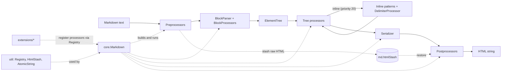

# Python-Markdown: Architecture Notes

This document describes how the `markdown` package is put together, why a few of the
main design decisions were made, and which rules should be kept when changing the code.
All paths are relative to the repository root.

## 1. Overview

Python-Markdown converts a Markdown string into an HTML string. The conversion is done by
one `Markdown` object (in `markdown/core.py`) that runs the text through a fixed sequence
of stages. Each stage is a `Registry` of small processor objects. Extensions change the
behaviour of the converter by adding, replacing or removing processors in these
registries. They do not change the stage order itself.

### Main components

| Component | Files | What it does |
|---|---|---|
| Core | `markdown/core.py`, `markdown/__init__.py` | Defines `Markdown`. Builds the five registries in `build_parser()`, loads extensions, runs `convert()`, and clears per-document state in `reset()`. |
| Preprocessors | `markdown/preprocessors.py`, `markdown/htmlparser.py` | Work on the list of source lines before parsing. The built-in ones normalise whitespace and pull raw HTML blocks out of the text into the HTML stash. |
| Block parser | `markdown/blockparser.py`, `markdown/blockprocessors.py` | `BlockParser` splits the text into blocks and offers each block to the registered `BlockProcessor`s in priority order. The first one whose `test()` returns true handles it. The result is an ElementTree under a root `div`. |
| Inline patterns | `markdown/inlinepatterns.py` | `InlineProcessor` subclasses that find inline syntax (code spans, links, images, autolinks, inline HTML, entities, emphasis) in the text of the tree. Emphasis is handled by a single `DelimiterProcessor` that is shared through `md.delimiters`. |
| Tree processors | `markdown/treeprocessors.py` | Walk and change the ElementTree. The built-in `InlineProcessor` tree processor is what actually applies the inline patterns. Many extensions (toc, footnotes, attr_list, abbr) also work at this stage. |
| Serializers | `markdown/serializers.py` | Turn the ElementTree into an HTML or XHTML string. The core picks one from `Markdown.output_formats` based on `output_format`. |
| Postprocessors | `markdown/postprocessors.py` | Work on the final string. They put the stashed raw HTML back in place of its placeholders and restore escaped ampersands. |
| Utilities | `markdown/util.py` | Shared helpers used by every stage: `Registry`, `HtmlStash`, `AtomicString`, the `Processor` base class and the placeholder constants. |
| Extensions | `markdown/extensions/` | `Extension` base class in `extensions/__init__.py` and the built-in extensions. Each extension hooks into one or more of the registries above. |

### Data flow

`Markdown.convert()` (`markdown/core.py`, around line 322) does the following, in order:

1. Split the source into lines and run every preprocessor on the list of lines.
2. Call `self.parser.parseDocument(lines)` to build an ElementTree.
3. Run every tree processor on the root element. The `inline` tree processor (priority 20)
   applies all inline patterns to the text of each element.
4. Serialize the tree with `self.serializer` and strip the wrapping `div`.
5. Run every postprocessor on the string.

Raw HTML never goes into the tree as text. It is stored in `md.htmlStash` and a placeholder
(`util.HTML_PLACEHOLDER`) is put in its place. `RawHtmlPostprocessor` swaps the placeholders
back at the end. Text that inline patterns must not touch again is wrapped in
`util.AtomicString`.

### Who calls whom

- `core` imports `preprocessors`, `blockprocessors`, `treeprocessors`, `inlinepatterns`,
  `postprocessors`, `serializers`, `util` and the `Extension` base class. It does not import
  any specific built-in extension.
- `treeprocessors` imports `inlinepatterns` (the inline tree processor runs the patterns).
- `blockprocessors` imports `blockparser`. `preprocessors` imports `htmlparser`.
- Every stage imports `util`. `util` imports nothing from the package at runtime.
- Extensions import from the stages they extend (for example `toc` imports `treeprocessors`
  and `util`; `legacy_em` imports `inlinepatterns.DelimiterProcessor`).

### Built-in registry contents and priorities

Higher priority runs first.

- Preprocessors: `normalize_whitespace` 30, `html_block` 20.
- Block processors: `empty` 100, `indent` 90, `code` 80, `hashheader` 70, `setextheader` 60,
  `hr` 50, `olist` 40, `ulist` 30, `quote` 20, `reference` 15, `paragraph` 10.
- Inline patterns: `backtick` 190, `escape` 180, `reference` 170, `link` 160, `image_link` 150,
  `image_reference` 140, `short_reference` 130, `short_image_ref` 125, `autolink` 120,
  `automail` 110, `linebreak` 100, `html` 90, `entity` 80, `em_strong` 60.
- Tree processors: `inline` 20, `prettify` 10, `unescape` 0.
- Postprocessors: `raw_html` 30, `amp_substitute` 20.

Some extension priorities that matter for ordering: footnotes tree processor 50 (runs before
inline), attr_list 8, abbr 7, toc 5 (runs after inline, so it sees the final heading content).

## 2. Architecture Decision Records

### ADR-1: Processors are kept in a priority-sorted `Registry`

Status: Verified (3.0 changelog entry "Homegrown `OrderedDict` has been replaced with a
purpose-built `Registry`"; docstring of `Registry` in `markdown/util.py`).

Context. Every stage needs an ordered collection that extensions can add to, remove from,
or insert into at a specific point relative to other items. Older versions used a custom
`OrderedDict` where items were placed with strings like `"<emphasis"`, which was hard to
reason about and broke when two extensions targeted the same anchor.

Decision. Use `util.Registry`. Each item is registered with `register(item, name, priority)`.
The registry sorts by priority (highest first) when it is iterated. Registering an existing
name replaces the old item. `deregister(name)` removes one.

Alternatives considered. Plain lists with index-based insertion; the old `OrderedDict` with
relative position strings.

Consequences. Extensions only need to pick a number between two existing priorities. Items
can be looked up and replaced by name, so an extension can swap out a built-in processor
(for example `sane_lists` re-registers `olist` and `ulist`). The order of the whole pipeline
is decided only by numbers, so a wrong priority is a silent bug. The old dict-style API
(`__setitem__`, `__delitem__`, `add`) is deprecated.

### ADR-2: Extensions are classes loaded by name through entry points

Status: Verified (commit cd73243 "Refactor Extension loading (#627)"; 3.0 changelog section
on entry points; `Markdown.build_extension` in `markdown/core.py`).

Context. Users pass extensions as strings or objects. Earlier versions special-cased built-in
names and third-party names starting with `mdx_`, which needed fragile import rules.

Decision. An extension is a subclass of `markdown.extensions.Extension` that overrides
`extendMarkdown(md)`. A module that provides one also defines `makeExtension(**kwargs)`.
A short name such as `'toc'` is resolved through the `markdown.extensions` entry point group.
Built-in extensions declare their entry points in `pyproject.toml` under
`[project.entry-points.'markdown.extensions']`. Any other string is treated as a dotted import
path (`'markdown.extensions.toc'` or `'package.module:Class'`).

Alternatives considered. Hard-coded name lists inside the core; the old `mdx_` prefix
convention.

Consequences. Built-in and third-party extensions are loaded the same way. A new built-in
extension is not available by its short name until its entry point is added to
`pyproject.toml` and the package metadata is reinstalled. Extensions get their configuration
through the `config` dict and `getConfigs()` of the base class.

### ADR-3: All emphasis-like delimiters share one `DelimiterProcessor`

Status: Verified (commit 6f825aa "Rewrite emphasis handling", changelog entry "Complete
rework of emphasis handling to improve nested emphasis handling better (#1632)").

Context. Emphasis used to be handled by many regex patterns run in several passes. Nested
and overlapping markers such as `***a* b**` or `*a **b* c**` were resolved in odd ways, and
every new marker added more patterns whose relative priorities had to be tuned by hand.

Decision. One `DelimiterProcessor` (in `markdown/inlinepatterns.py`) scans for all registered
delimiter tokens together, keeps a stack per token and builds the nested elements in one
go. It is registered as the `em_strong` inline pattern and also stored on the Markdown
instance as `md.delimiters`. The `*` token is passed to its constructor and `_` is added with
`md.delimiters.add('_', 'strong,em', smart=True)`. Other tokens are added the same way with
`add(token, tags, smart, double)`. `legacy_em` changes `_` by calling `md.delimiters.add` again.

Alternatives considered. Keep one regex pattern per marker and per nesting combination;
register a separate processor for each new marker.

Consequences. Because all tokens are matched by one processor, nesting and overlaps between
different markers are resolved consistently. A new marker that registers its own separate
processor will not take part in that resolution. The processor caches regions between calls,
so `Markdown.reset()` calls `md.delimiters.reset()` and sets `md.delimiters` to `None` if the
processor was removed from the inline registry. Code that adds a token must handle the case
where `md.delimiters` is `None` (see `legacy_em.py`).

## 3. Constraints

| # | Rule | Where it can be seen |
|---|---|---|
| C1 | Add, replace or remove processors only through the stage registries with `register(item, name, priority)` and `deregister(name)`. Do not reorder or index-insert into them by hand. | `markdown/util.py` (`Registry.register`, line 362), `markdown/core.py` lines 154-158 |
| C2 | A new extension must subclass `Extension`, override `extendMarkdown(md)`, and provide `makeExtension(**kwargs)`. A new built-in extension must also get an entry point in `pyproject.toml`. | `markdown/extensions/__init__.py` lines 37 and 132, `pyproject.toml` lines 73-91, `markdown/core.py` line 218 |
| C3 | New emphasis-like inline markers must be added to the shared `md.delimiters` processor with `md.delimiters.add(...)`. Only if `md.delimiters` is `None` should a new `DelimiterProcessor` be registered, under the name `em_strong`. | `markdown/extensions/legacy_em.py` lines 33-36, `markdown/inlinepatterns.py` lines 93-94, `markdown/core.py` lines 122 and 275-278 |
| C4 | An extension that keeps state between calls must call `md.registerExtension(self)` and implement `reset()`, because `Markdown.reset()` only resets registered extensions. | `markdown/core.py` lines 250 and 280-282, `markdown/extensions/toc.py` lines 507 and 513, `markdown/extensions/footnotes.py` lines 99 and 128 |
| C5 | Core modules (`markdown/*.py`) must not import specific built-in extensions. The dependency goes from `extensions/` to the core, and the core only imports the `Extension` base class. | `markdown/core.py` line 33, `markdown/__init__.py` line 46 |
