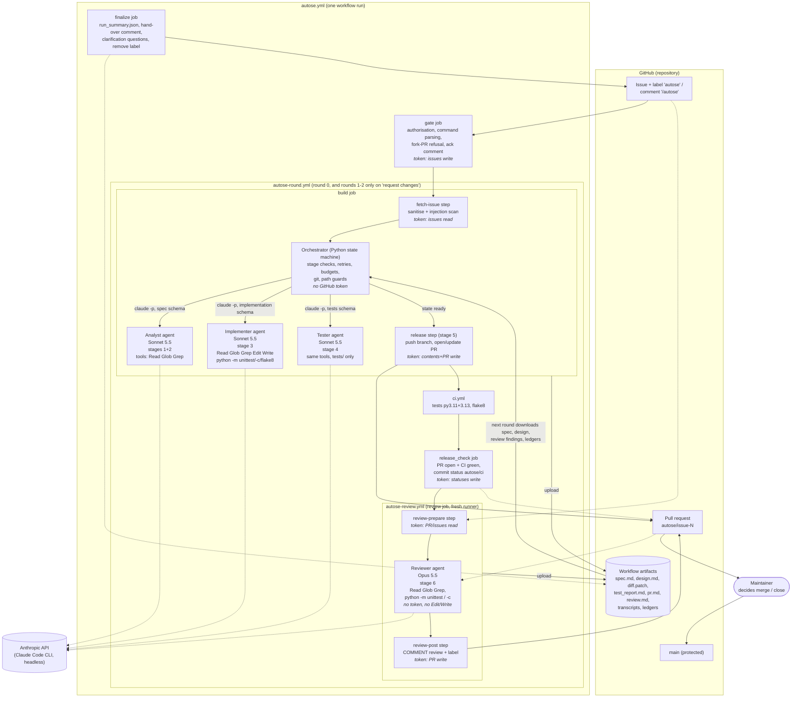

# Component view

Agents, their tools, and who calls whom. Solid arrows are calls/hand-offs, dotted arrows are
reads. Boxes inside a job share a runner; different jobs share nothing except uploaded artifacts.

## Notes

- **Four agent roles, one orchestrator.** The orchestrator is ordinary Python. It calls each agent as a
  separate headless Claude Code process with its own system prompt, tool allow list, JSON output schema,
  turn limit and dollar budget. Agents never call each other; they only hand over structured artifacts
  through the orchestrator.
- **Stage 5 has no agent.** Pushing, opening the PR and checking CI are deterministic.
- **Where tokens live.** Steps that run agents never get a GitHub token. Steps that hold a token never
  run an agent. The reviewer's job downloads no build artifacts.
- **Trusted code.** The orchestrator and prompts are always checked out from the default branch
  (`tool/`); the agents work in a separate sparse checkout (`work/`) that does not contain
  `workflow/`, `.github/`, `experiment/`, `results/`, `architecture/` or `scripts/`.
