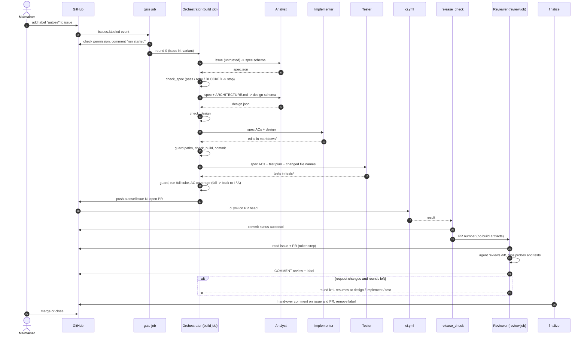
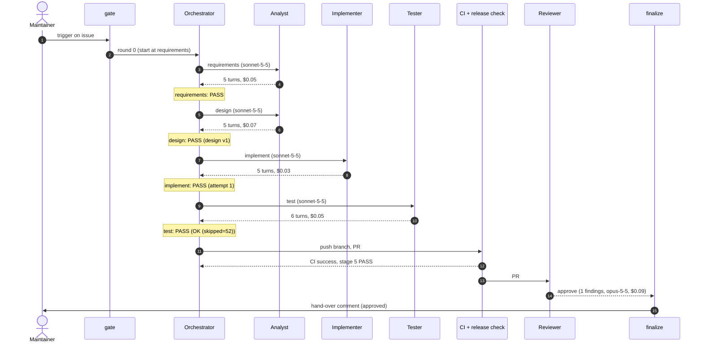

# Sequence view

The assignment asks for the sequence of **one real run**, from the trigger to the posted review.
Generate it from that run's artifacts after the run (so every step and number in it is real):

```bash
gh run download <run-id> --repo <owner>/<repo> --dir runs/<run-id>
python scripts/make_sequence_view.py runs/<run-id> --run-url https://github.com/<owner>/<repo>/actions/runs/<run-id> \
    >> architecture/views/sequence_view.md
```

The generic shape of a run (no real data) is shown below for orientation only.



## Sequence of run https://github.com/nanchan1912/autose-a3/actions/runs/45375233794

Issue #1, PR #13, variant `default`, outcome **approved**.



Total: 5 agent calls, $0.29.

